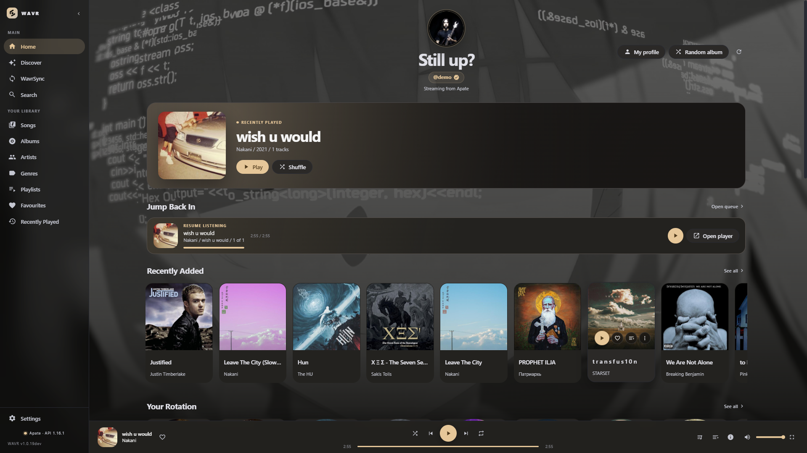
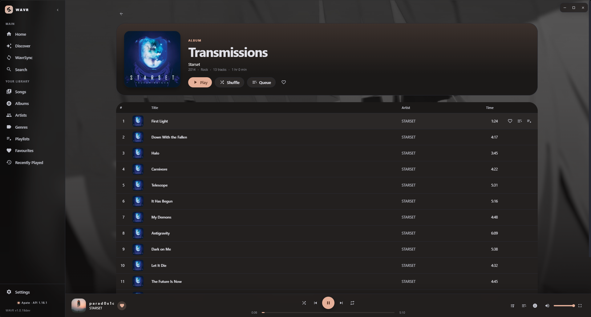
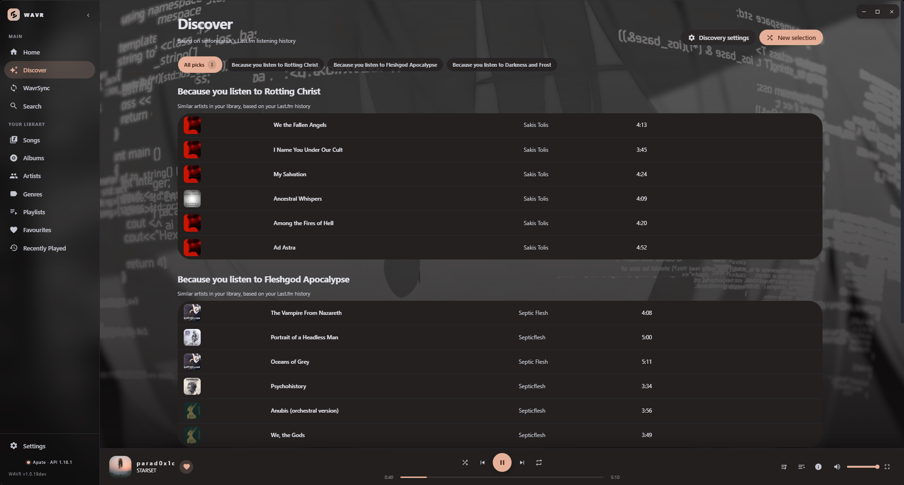
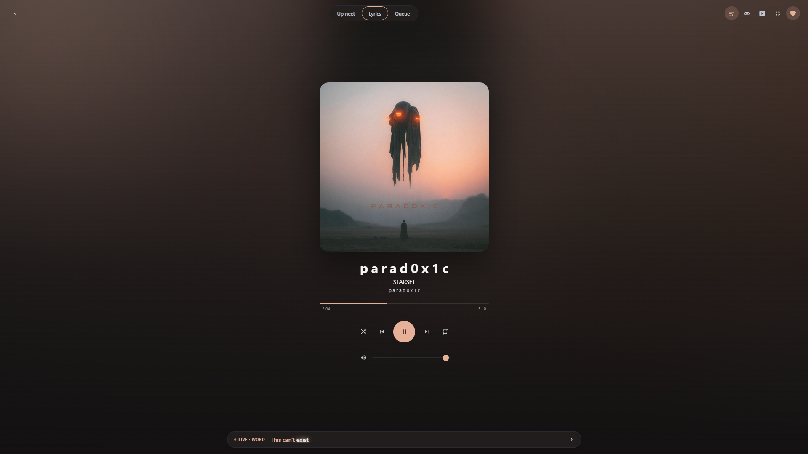
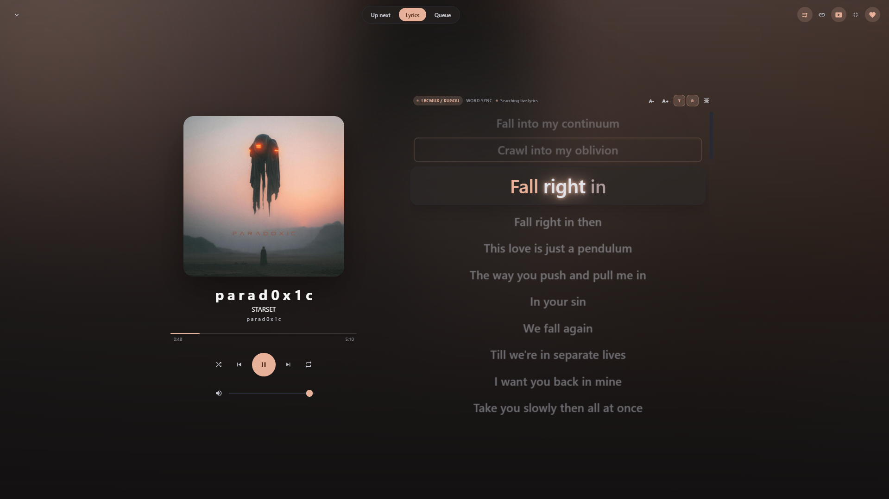
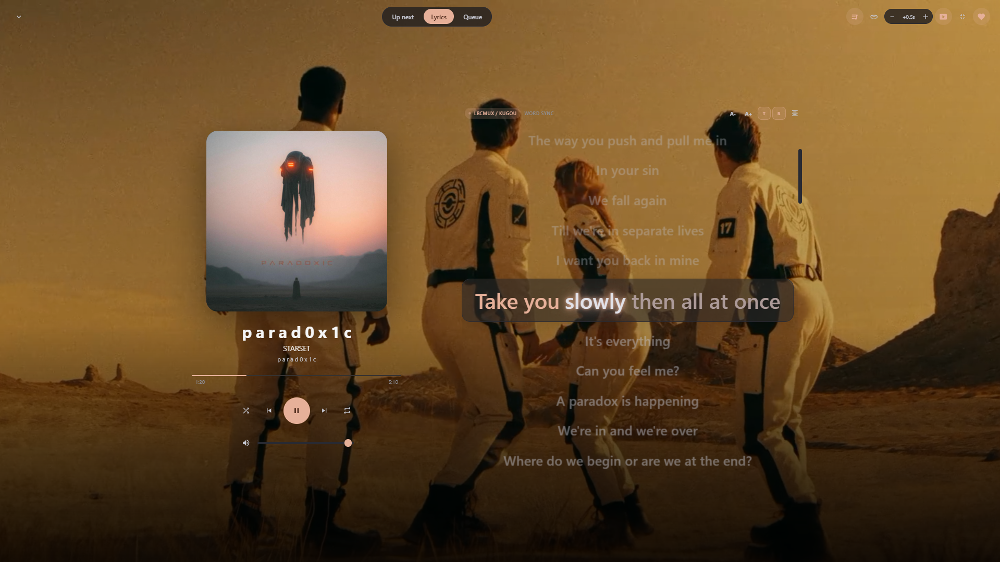
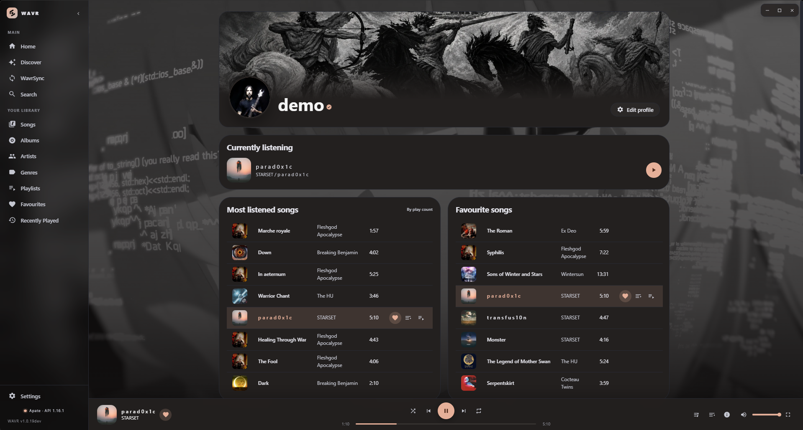

<h1 align="center">Wavr</h1>
<p align="center">
  
</p>

WAVR is a beautiful desktop music player for Navidrome, Airsonic, Gonic, and other Subsonic/OpenSubsonic-compatible servers. It connects directly to your existing server - no plugins or server-side changes required.

Built with Electron, React, TypeScript, and Vite. WAVR keeps your library and credentials on your own hardware while providing a fast, keyboard-friendly desktop experience.

## Features

- Multiple server profiles with one-click switching
- Personalised home hero, Jump Back In, Recently Added, rotation, recommendations, rediscovery, history, and most-played shelves
- Discover feeds with multiple Because you like tabs and sections built from your library and Last.fm
- Browse artists, albums, songs, genres, playlists, and favourites
- Debounced global search across songs, artists, albums, and playlists, with artwork and direct playback actions
- Refined album cards with hover/touch controls, queue, favourites, and contextual menus
- Persistent mini-player with full playback, queue, volume, lyrics, and progress controls
- Streaming playback with play/pause, next/previous, seek, volume, and mute
- Audiophile playback controls: server-side format/bitrate transcoding and a functional 10-band equaliser with presets
- Integrated top-right window controls with a draggable frameless layout
- Discord Rich Presence for the current track, configurable with your own Discord application ID
- Last.fm and Libre.fm scrobbling with browser authorization, now-playing updates, and retry queue
- WavrSync for synchronized listening, public/private rooms, shared profile pictures, profiles, invites, queue controls, and host controls
- Automatic update checks and downloads through a self-hosted update server, with all-updates or critical-only policies
- WASAPI shared and exclusive output on Windows, PipeWire output on Linux, through the native WavrPulse sidecar with a browser fallback
- Queue management: add, play next, reorder, remove, clear, and save as playlist
- Shuffle and repeat modes with media-key and OS media-session support
- Persistent queue per server, restored on launch
- Expanded now-playing view with artwork, queue tabs, full-screen mode, and a live lyric banner
- Immersive lyrics with adjustable text size and alignment, transparent full-screen presentation, and server/live-provider metadata
- Syllable-, word-, and line-synced lyrics from Lyrica, falling back to the connected server
- Dynamic Material 3 palette extracted from the current artwork
- Light, dark, and system-matched themes; fixed or artwork accents; density and reduced-motion settings
- Secure credential storage using the operating system credential store
- System tray, window-state persistence, and a frameless window with integrated navigation and window controls
- Accessible controls, focus states, and reduced-motion support

## Stack

- **Desktop:** Electron 44
- **Frontend:** React 19, TypeScript 7, Vite 8
- **Design:** Material Design 3 Expressive with CSS custom properties
- **API:** Typed Subsonic/OpenSubsonic client with salted-token authentication
- **Playback:** WavrPulse native WASAPI (Windows) / PipeWire (Linux) sidecar with HTMLAudioElement fallback
- **Lyrics:** [Lyrica](https://github.com/Wilooper/Lyrica) multi-provider resolver with server lyrics fallback
- **WavrSync:** Node WebSocket room server with optional JSON persistence and `wavr://` invite links
- **State:** Lightweight external store with shallow-compared selectors
- **Tests:** Vitest and jsdom

## Project structure

```
src/
  main/           Electron main process (windows, IPC, tray, media keys, media proxy)
  preload/        Context-isolated preload bridge
  renderer/
    app/          App shell, routing, connect dialog
    components/   Shared UI (Icon, Button, Artwork, MediaCard, TrackList, ...)
    features/     Home, Search, Artists, Albums, Songs, Genres, Playlists,
                  Favourites, Queue, WavrSync, Lyrics, Settings, Player
    services/     Subsonic server service, playback engine, lyrics resolver, WavrSync client, toasts
    state/        Typed store and React hooks
    styles/       Material 3 tokens and component styles
    themes/       Theme provider and dynamic colour engine
shared/
  api/            Subsonic client, authentication, capability probing
  models/         Shared data models
  constants/      Branding, defaults, formatters
native/           Rust WavrPulse audio-engine sidecar (WASAPI on Windows, PipeWire on Linux)
tests/unit/       Unit tests for auth, MD5, lyrics, scrobbling, WavrSync, store, and theme utilities
```

## Getting started

```bash
npm i
npm start
```

`npm start` builds the renderer and Electron processes, then launches WAVR.

### Development

```bash
npm run dev
```

Starts the Vite dev server and Electron with hot reload for the renderer.

### Verification

```bash
npm run typecheck
npm test
```

### Packaging

```bash
npm run build
```

Creates an installer in `release/` using electron-builder. Windows builds target NSIS x64; Linux targets deb and AppImage; macOS targets DMG and ZIP.

Linux WavrPulse builds require `pkg-config`, `libpipewire-0.3-dev`, `libspa-0.2-dev`, and `libclang-dev` (for the PipeWire bindings). The Linux package bundles the PipeWire client library used by WavrPulse.

## Automatic updates

WAVR checks a self-hosted update feed on startup when **Settings -> Updates -> Automatic updates** is enabled. The default is `https://update.listenwavr.xyz`; change it there if you host the update server elsewhere. Choose **All updates** or **Critical only** in Settings. After installation WAVR relaunches automatically.

Host the update server with Docker:

```bash
cd WavrSync
cp .env.example .env
# Set WAVR_UPDATE_PUBLIC_URL to your public HTTPS URL.
docker compose up -d --build
```

Copy installers named like `WAVR-0.9.0-beta-win-x64.exe` into `WavrUpdater/releases/`. The server publishes a manifest and download endpoint; WAVR downloads in the background, verifies SHA-512, and offers **Restart and update** in Settings.

See `WavrUpdater/README.md` for the reverse-proxy and release-directory details.

## Setup bootstrapper

`release/WAVR-Setup.exe` is a small (~65 KB) Windows bootstrapper that always installs the latest stable WAVR release. Instead of shipping a fixed installer it:

1. Resolves the newest stable build for the running architecture from `https://update.listenwavr.xyz/api/update/latest`.
2. Downloads the installer to `%TEMP%\WAVR-Setup\` with a live progress bar.
3. Verifies the SHA-512 checksum and size against the manifest.
4. Launches the WAVR installer (silently with `/S` when requested).

Build it with:

```bash
npm run build:setup
```

This uses the .NET Framework `csc.exe` bundled with Windows, so no extra toolchain is required. Verify the feed end to end with:

```bash
npm run build:setup:check   # compile, resolve the latest release, download and verify it
```

### Command line

| Flag | Description |
| --- | --- |
| `/S`, `--silent` | Run the downloaded installer silently. |
| `--channel=<name>` | Update channel to resolve (`stable` by default). |
| `--arch=<arch>` | Override the detected architecture (`x64` or `arm64`). |
| `--feed=<url>` | Use a different update server. |
| `--no-launch` | Download only; do not start the installer. |
| `--check` | Headless mode: resolve the feed and write a JSON report, then exit. |
| `--download` | With `--check`, also download and verify the installer. |
| `--report=<path>` | Report path for `--check` (defaults to `wavr-setup-check.json`). |

The bootstrapper is a managed .NET Framework executable and requires no runtime install beyond the .NET Framework 4.x that ships with Windows 10 and 11.

## Scrobbling

Open **Settings → Scrobbling**, choose Last.fm or Libre.fm, and enter the API key and shared secret for your registered application. Connect the account in the browser; WAVR stores the session key in the operating system credential store.

Tracks submit after 50% or four minutes, whichever comes first. Tracks of 30 seconds or less are ignored. Failed scrobbles are queued locally and retried.

## WavrSync shared listening

WavrSync uses a standalone WebSocket backend in `WavrSync/`.

The default backend address is `ws://127.0.0.1:8787`. Open **WavrSync**, connect, then create or join a room. Invite codes and `wavr://wavrsync/join/CODE` links can be shared with other WAVR listeners. Room hosts can change visibility and manage the queue, and listener profiles with avatars, banners, tags, friends, Subsonic stats, favourites and playlists are shared through the WavrSync server.

Host it on a server with Docker Compose:

```bash
cd WavrSync
cp .env.example .env
# Set WAVRSYNC_PUBLIC_URL to your public HTTPS URL.
docker compose up -d --build
```

Use `wss://your-domain.example` as the WavrSync server URL in WAVR. The Compose setup stores room state in a named volume and exposes port `8787` by default.

See `WavrSync/README.md` for environment variables, reverse-proxy WebSocket configuration, and endpoints. Set `WAVRSYNC_PUBLIC_URL` when the server is reachable outside your machine. Discord Rich Presence adds a room party and an HTTPS invite button when a public URL is configured.

## Connecting a server

On first launch WAVR opens the connection dialog. Enter a display name, server URL, username, and password. Use **Test connection** to verify the server and inspect capabilities, then **Save & connect**.

Server URLs may be entered with or without a scheme. HTTPS is recommended for any server reachable outside your local network.

WAVR detects the Subsonic API version and OpenSubsonic extensions, then hides actions the server does not support (genres, favourites, lyrics, play queue, top songs).

## Keyboard shortcuts

| Shortcut | Action |
| --- | --- |
| Space | Play or pause |
| Ctrl/Cmd + K | Focus global search |
| Ctrl/Cmd + Left/Right | Seek 10 seconds |
| Ctrl/Cmd + Up/Down | Volume up or down |
| Q | Toggle the queue drawer |
| L | Open lyrics |
| M | Mute or unmute |
| F | Toggle favourite for the current track |
| Esc | Close the player, queue drawer, or dialog |
| F11 | Toggle full screen |
| F12 | Toggle developer tools in development and beta builds |

## Security

- Renderer runs with context isolation enabled and Node integration disabled.
- A restrictive Content Security Policy limits scripts, styles, media, and network access.
- Passwords are encrypted with Electron `safeStorage` (the operating system credential store) before settings are written to disk. Plaintext is only used in memory.
- Artwork is loaded through a privileged `wavr-media` protocol that restricts requests to the configured server and adds CORS headers for colour extraction.
- Subsonic authentication uses a random salt and MD5 token; credentials are never logged.
- Lyrica requests contain only track title, artist, and sync options. Credentials and server URLs are never sent.
- Remote HTTP servers are allowed for local use, but HTTPS is recommended and surfaced in the UI.

## Known limitations

- Gapless playback and crossfade are not implemented.
- No audio visualiser or equaliser; streams are played directly by the audio element.
- Discord Rich Presence requires your own Discord application ID and the Discord desktop client running.
- Packaging is configured but not tested on every platform.
- Online lyrics depend on the Lyrica API and fall back to server lyrics when it is unavailable or rate-limited. Server fallback requires OpenSubsonic `songLyrics` or legacy `getLyrics`.
- Stream format and bitrate controls depend on the server supporting Subsonic transcoding parameters. Original playback is requested when no transcoding format is selected.
- Lyrica uses a public demo endpoint by default. Word- and syllable-level results depend on upstream source availability; line-level and server fallback remain available.

## Screenshots
### WavrMusic Interface
<p align="center">
  
</p>

### Album Page
<p align="center">
  
</p>

### Discover Page
<p align="center">
  
</p>

### Fullscreen
<p align="center">
  
</p>

### Lyrics
<p align="center">
  
</p>

### Fullscreen (with background)
<p align="center">
  
</p>

### Profile
<p align="center">
  
</p>
## Licence

GNU Affero General Public License v3.0

